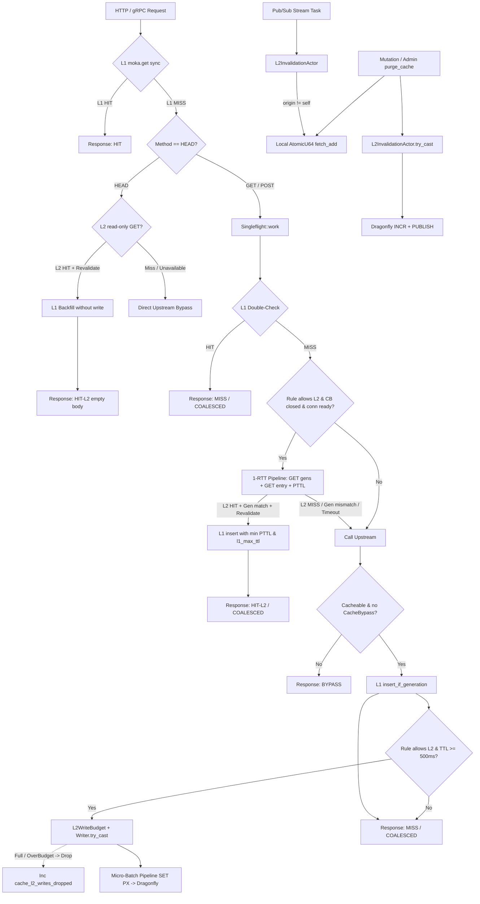
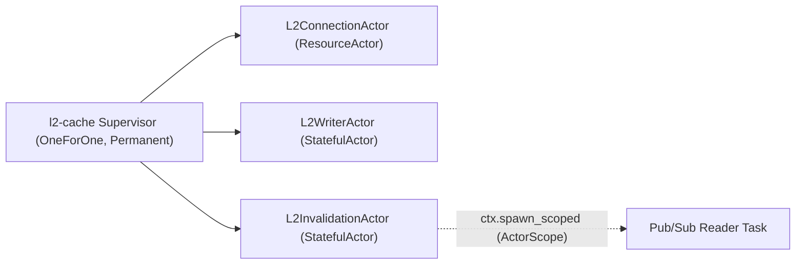

# L2-Response-Cache-Konzept: Dragonfly + `otp-actor` für `praeco-rs`

**Stand:** 28.11.2026  
**Status:** In Umsetzung auf Branch `feat/l2-cache-dragonfly` (**Schritte 1–5 abgeschlossen**)  
**Bezug:**  
- L1-Implementierung: [server/src/middleware/cache.rs](file:///Users/fredi/Data/Projekte/Rust/260225_Tower_Hyper_Rustls_refactor_client_gprc/server/src/middleware/cache.rs)  
- Konfiguration & Metriken: [server/src/configuration/mod.rs](file:///Users/fredi/Data/Projekte/Rust/260225_Tower_Hyper_Rustls_refactor_client_gprc/server/src/configuration/mod.rs)  
- Server-Lifecycle (`SIGHUP` / Shutdown): [server/src/server.rs](file:///Users/fredi/Data/Projekte/Rust/260225_Tower_Hyper_Rustls_refactor_client_gprc/server/src/server.rs)  
- Actor-Framework (`otp-actor` v0.4.3): [otp-actor Cargo.toml](file:///Users/fredi/Data/Projekte/Rust/261102_actor/Cargo.toml)  
- Bestehendes Security-/Performance-Review: [Review_261126.md](file:///Users/fredi/Data/Projekte/Rust/260225_Tower_Hyper_Rustls_refactor_client_gprc/Review_261126.md)

---

## 1. Kritische Prüfung des Erstentwurfs (`K-01` bis `K-10`)

Bevor Code geschrieben wird, wurde der erste L2-Entwurf systematisch gegen die reale `praeco-rs`-Codebasis und `otp-actor` v0.4.3 auditiert. Alle 10 identifizierten Risiken sind in die Spezifikation (Abschnitte 2 bis 9) eingearbeitet.

| ID | Kategorie | Schweregrad | Status | Kurztitel | Betroffene Stelle / Ursache | Lösung im finalen Konzept |
| :--- | :--- | :--- | :--- | :--- | :--- | :--- |
| **K-01** | Korrektheit / RAM | **KRITISCH** | **Behoben (Schritte 3–5, 28.11.2026)** | Lokale Generationen im L2-Key verursachen Split-Brain, Stale-Reads & Zombie-Keys | [cache.rs](file:///Users/fredi/Data/Projekte/Rust/260225_Tower_Hyper_Rustls_refactor_client_gprc/server/src/middleware/cache.rs#L598-L605) (`current_generation`) | Generationsfreier Slot-Key, `PRC2`-Generation-Check & 1-RTT-Dragonfly-Pipeline (`GET`/`PTTL`) in [cache_l2_dragonfly.rs](file:///Users/fredi/Data/Projekte/Rust/260225_Tower_Hyper_Rustls_refactor_client_gprc/server/src/middleware/cache_l2_dragonfly.rs) aktiv & getestet |
| **K-02** | Korrektheit / Plattform | **KRITISCH** | **Behoben (Schritte 3–4, 28.11.2026)** | `Instant::now() - age` Underflow & falsche L1-Expiry nach L2-Backfill | [cache.rs](file:///Users/fredi/Data/Projekte/Rust/260225_Tower_Hyper_Rustls_refactor_client_gprc/server/src/middleware/cache.rs#L448-L450), [cache.rs](file:///Users/fredi/Data/Projekte/Rust/260225_Tower_Hyper_Rustls_refactor_client_gprc/server/src/middleware/cache.rs#L1442) | `initial_age: Duration` auf `CachedResponse` + Backfill mit `l1_max_ttl` im Flow integriert & getestet |
| **K-03** | Latenz / Availability | **HOCH** | **Behoben (Schritt 5, 28.11.2026)** | `ResourceClient::get()` blockiert im Kaltstart/Reconnect über die Mailbox | [generic_actor.rs](file:///Users/fredi/Data/Projekte/Rust/261102_actor/src/actor/generic_actor.rs#L1994-L2022) | Lock-freie 0-ns Vorabprüfung über [`ResourceClient::cache_state()`](file:///Users/fredi/Data/Projekte/Rust/261102_actor/src/actor/generic_actor.rs#L2042-L2047) & gedrosseltes `force_refresh()` in [cache_l2_dragonfly.rs](file:///Users/fredi/Data/Projekte/Rust/260225_Tower_Hyper_Rustls_refactor_client_gprc/server/src/middleware/cache_l2_dragonfly.rs) aktiv & getestet |
| **K-04** | Build / TLS | **HOCH** | **Behoben (Schritt 1 & 5, 28.11.2026)** | `redis`-TLS-Feature kann `ring` neben `aws-lc-rs` einschleppen | [Cargo.toml](file:///Users/fredi/Data/Projekte/Rust/260225_Tower_Hyper_Rustls_refactor_client_gprc/Cargo.toml#L62), [deny.toml](file:///Users/fredi/Data/Projekte/Rust/260225_Tower_Hyper_Rustls_refactor_client_gprc/deny.toml) | `redis 1.8.3` mit `tokio-rustls-comp` + `tls-rustls-webpki-roots`, reines `aws_lc_rs` & CA/mTLS-Client-Builder in `build_redis_client` aktiv & getestet |
| **K-05** | Sicherheit (`S-02`) | **HOCH** | **Behoben (Schritte 3–4, 28.11.2026)** | Verkürzter 64-Bit-Namespace-Hash & fehlende `Vary`/`max_entry_bytes`-Revalidierung bei L2-HIT | [cache.rs](file:///Users/fredi/Data/Projekte/Rust/260225_Tower_Hyper_Rustls_refactor_client_gprc/server/src/middleware/cache.rs#L1568-L1593) | 256-Bit-`ns_tag` + `l2_entry_passes_local_policy` (`Vary`, `max_entry_bytes`, `Cache-Control`) aktiv & getestet |
| **K-06** | Speicher / DoS | **MITTEL-HOCH** | **Behoben (Schritte 2, 3 & 5, 28.11.2026)** | Unbegrenztes Byte-Volumen in `L2WriterActor`-Mailbox & bei großen L2-Reads | `write_queue_capacity = 256` × `max_write_queue_bytes = 32 MiB` | `L2WriteBudget` + `L2WriterActor::try_cast`-Backpressure, Zip-Bomb-Guard & `MAX_WIRE_HEADER_OVERHEAD` aktiv & getestet |
| **K-07** | Korrektheit / DoS | **MITTEL** | **Behoben (Schritte 4–5, 28.11.2026)** | `fetch_max` auf lokaler Generation bricht nach Dragonfly-Restart; Pub/Sub-`DashMap`-DoS | [cache.rs](file:///Users/fredi/Data/Projekte/Rust/260225_Tower_Hyper_Rustls_refactor_client_gprc/server/src/middleware/cache.rs#L560), [cache.rs](file:///Users/fredi/Data/Projekte/Rust/260225_Tower_Hyper_Rustls_refactor_client_gprc/server/src/middleware/cache.rs#L662-L675) | `L2InvalidationActor` mit `ActorScope`, `origin_node_id`-Echo-Filter, Backoff-Reconnect & Restart-Resync (`cur != prev`) inkl. `MAX_TRACKED_NAMESPACES` aktiv & getestet |
| **K-08** | Performance / Protokoll | **MITTEL** | **Behoben (Schritt 4, 28.11.2026)** | Fehlender L1-Double-Check im `Singleflight`-Leader & ungenutztes L2 bei `HEAD` | [cache.rs](file:///Users/fredi/Data/Projekte/Rust/260225_Tower_Hyper_Rustls_refactor_client_gprc/server/src/middleware/cache.rs#L2225), [cache.rs](file:///Users/fredi/Data/Projekte/Rust/260225_Tower_Hyper_Rustls_refactor_client_gprc/server/src/middleware/cache.rs#L2656) | L1-Double-Check (`CachedL1`) & Read-Only-L2-Lookup für `HEAD` ohne L2-Write aktiv & getestet |
| **K-09** | Performance / Stabilität | **NIEDRIG-MITTEL** | **Behoben (Schritte 3–4, 28.11.2026)** | Eviction-Churn bei winzigen Rest-TTLs & konsequente Einhaltung von `CacheBypass` | [cache.rs](file:///Users/fredi/Data/Projekte/Rust/260225_Tower_Hyper_Rustls_refactor_client_gprc/server/src/middleware/cache.rs#L1605-L1625) | `MIN_L2_HIT_REMAINING_TTL` (`100 ms`), `MIN_L2_WRITE_TTL` (`500 ms`), Bypass- & `PerSubject`-Guards aktiv & getestet |
| **K-10** | Sicherheit / Codequalität | **NIEDRIG-MITTEL** | **Teilweise behoben (Schritt 2, 27.11.2026)** | Klartext-Passwörter in Redis-URLs & projektweites `deny(unwrap_used, expect_used)` | [server/src/lib.rs](file:///Users/fredi/Data/Projekte/Rust/260225_Tower_Hyper_Rustls_refactor_client_gprc/server/src/lib.rs#L1) | Inline-Passwort in `L2CacheConfig::validate()` verboten, redaktiertes `Debug` + `redacted_url()`, 0 `unwrap`/`expect`; `/status`-Redaktion folgt in Schritt 7 |

### Detailanalyse der kritischen Befunde

#### `K-01` (KRITISCH): Lokale Generationen im L2-Key → Split-Brain, Stale-Reads & Zombie-Keys
- **Ursache im Erstentwurf:** Der Dragonfly-Key sollte `{global_gen}:{ns_gen}` aus [`SharedResponseCache::current_generation`](file:///Users/fredi/Data/Projekte/Rust/260225_Tower_Hyper_Rustls_refactor_client_gprc/server/src/middleware/cache.rs#L598-L605) einbetten.
- **Auswirkung:**
  1. **Cache-Split:** Ein frisch gestarteter Node B beginnt bei Generation `(0, 0)`, während Node A in Dragonfly längst auf `(0, 12)` schreibt. Beide Nodes teilen keinen einzigen L2-Eintrag.
  2. **Stale-Read-Bug:** Liegt unter `:0:0:` in Dragonfly noch ein älterer Eintrag mit laufender TTL, liest Node B bereits invalidierte Daten und schreibt sie in seinen L1.
  3. **Dragonfly-RAM-Amplifikation:** Bei jeder Invalidierung bleiben alle Vorgängerversionen bis zum Ablauf ihrer `PX`-TTL als verwaiste Zombie-Keys im Speicher liegen.
- **Lösung:**
  - Dragonfly ist alleinige *Single Source of Truth* für L2-Generationen (`{prefix}:v1:gen:global` und `{prefix}:v1:gen:ns:{ns_tag}`).
  - Der Daten-Key enthält **keine** Generation (`{prefix}:v1:e:{ns_tag}:{entry_sha256_hex}`), sodass Updates in-place überschreiben.
  - Der L2-Read lädt in **1 RTT per Pipeline** `(gen:global, gen:ns:{ns_tag}, entry_key, PTTL entry_key)`. Der Wert gilt nur als HIT, wenn die im Wire-Header kodierte `(remote_global_gen, remote_ns_gen)` exakt mit der aktuellen Dragonfly-Generation übereinstimmt.
  - Selbst bei einem Write-Race ($T_0$ Miss bei Gen 12 → $T_1$ Invalidation auf Gen 13 → $T_2$ verzögerter Writer-Flush mit Gen 12) verwirft jeder nachfolgende Reader den Eintrag sofort wegen `12 != 13`.

#### `K-02` (KRITISCH): `CachedResponse::stored_at: Instant` nach L2-Backfill
- **Ursache im Erstentwurf:** [`CachedResponse`](file:///Users/fredi/Data/Projekte/Rust/260225_Tower_Hyper_Rustls_refactor_client_gprc/server/src/middleware/cache.rs#L448-L450) prüft `entry.stored_at.elapsed() >= entry.ttl` ([cache.rs:616](file:///Users/fredi/Data/Projekte/Rust/260225_Tower_Hyper_Rustls_refactor_client_gprc/server/src/middleware/cache.rs#L616)) und berechnet den `Age`-Header via `entry.stored_at.elapsed().as_secs()` ([cache.rs:1442](file:///Users/fredi/Data/Projekte/Rust/260225_Tower_Hyper_Rustls_refactor_client_gprc/server/src/middleware/cache.rs#L1442)).
- **Auswirkung:** Ein Zurückrechnen von `stored_at = Instant::now() - age` kann auf kurz laufenden Containern/VMs (`CLOCK_MONOTONIC` / `mach_absolute_time` kleiner als `age`) per `checked_sub` fehlschlagen (`None`) und würde bei gekappter L1-TTL (`l1_max_ttl`) dazu führen, dass `stored_at.elapsed() >= l1_max_ttl` den Eintrag in L1 sofort als abgelaufen markiert.
- **Lösung:** `CachedResponse` erhält `pub initial_age: Duration` (`Duration::ZERO` beim Origin-Fetch, `original_ttl.saturating_sub(pttl)` beim L2-Backfill). `stored_at` bleibt immer `Instant::now()`, `ttl` bleibt `min(pttl, l1_max_ttl)`, und `Age` wird als `entry.initial_age.saturating_add(entry.stored_at.elapsed()).as_secs()` berechnet.

#### `K-03` (HOCH): Versteckte Hotpath-Blockade in `ResourceClient::get()`
- **Ursache im Erstentwurf:** [`ResourceClient::get`](file:///Users/fredi/Data/Projekte/Rust/261102_actor/src/actor/generic_actor.rs#L1994-L2022) bedient den 0-Hop-`watch`-Fast-Path nur, wenn bereits eine gültige Ressource veröffentlicht wurde. Im Kaltstart oder während eines fehlgeschlagenen Reconnects fällt `get()` in die 1-Hop-Mailbox-Schleife (`ResourceCommand::GetResource`), wartet bis zum `connect_timeout_ms` oder bricht erst bei `max_waiters` mit `ResourceError::Overloaded` ab.
- **Auswirkung:** Bei totem/kaltem Dragonfly würden parallele `Singleflight`-Leader unnötig auf den Verbindungsaufbau warten. Zudem markiert `TimedResource::perpetual` eine `ConnectionManager`-Instanz nie von selbst als abgelaufen.
- **Lösung:** Vor dem Zugriff auf `conn_client.get()` prüft der Hotpath synchron und lock-free [`conn_client.cache_state()`](file:///Users/fredi/Data/Projekte/Rust/261102_actor/src/actor/generic_actor.rs#L2042-L2047). Nur bei `CacheState::Fresh | CacheState::RefreshDue | CacheState::StaleUsable` wird `conn_client.get_timeout(...)` aufgerufen; in allen anderen Zuständen kehrt der Read in **0 ns** mit `L2GetOutcome::Unavailable` zurück (Fail-Open). Öffnet der Circuit Breaker oder schlägt ein Read wegen Dead-Socket fehl, stößt der Aufrufer gedrosselt `conn_client.force_refresh()` im Hintergrund an.

#### `K-04` (HOCH): `rustls` CryptoProvider-Konflikt (`aws-lc-rs` vs. `ring`)
- **Ursache im Erstentwurf:** `praeco-rs` verwendet durchgängig `rustls = "0.23"` mit `aws_lc_rs` ([Cargo.toml](file:///Users/fredi/Data/Projekte/Rust/260225_Tower_Hyper_Rustls_refactor_client_gprc/Cargo.toml#L62)). Unspezifische `redis/tls-rustls`-Features können `ring` in den Dependency-Graph ziehen.
- **Auswirkung:** Doppelte Krypto-Backends, potenzieller Laufzeit-Panic bei `CryptoProvider`-Initialisierung und Verstöße gegen [deny.toml](file:///Users/fredi/Data/Projekte/Rust/260225_Tower_Hyper_Rustls_refactor_client_gprc/deny.toml).
- **Lösung:** `redis` wird mit `default-features = false` eingebunden. TLS-Streams zu Dragonfly werden explizit mit `tokio-rustls` + `rustls::crypto::aws_lc_rs::default_provider()` aufgebaut (inkl. `tls_ca_file` und optionaler mTLS-Client-Zertifikate). `cargo tree -e features -i rustls --features cache-l2-dragonfly` darf kein `ring` enthalten.

#### `K-05` (HOCH): Namespace-Kollisionsmarge & fehlende L2-HIT-Revalidierung
- **Ursache im Erstentwurf:** 64-Bit-Namespace-Hash (`ns_hash16`) und blindes Übernehmen von `CachedResponse` aus L2 ohne Prüfung lokaler Rule-Policies.
- **Auswirkung:** Bei Rolling-Updates oder unterschiedlichen Server-Regeln im selben `namespace` könnte ein Node eine Response aus L2 übernehmen, deren `Vary`-Header lokal nicht abgedeckt ist oder deren Größe `rule.max_entry_bytes` überschreitet (Verletzung von `S-02` in [Review_261126.md](file:///Users/fredi/Data/Projekte/Rust/260225_Tower_Hyper_Rustls_refactor_client_gprc/Review_261126.md#L19)).
- **Lösung:** Voller 256-Bit SHA-256 Digest für den Namespace (`ns_tag`, 64 Hex-Zeichen) als Redis-Hash-Tag `{ns_tag}`; nach erfolgreichem `decode_cached_response` prüft der empfangende Node erneut `entry.body.len() <= max_entry_bytes` und [`response_vary_is_cacheable(&entry.headers, &rule)`](file:///Users/fredi/Data/Projekte/Rust/260225_Tower_Hyper_Rustls_refactor_client_gprc/server/src/middleware/cache.rs#L1568-L1593).

#### `K-06` (MITTEL-HOCH): Unbegrenztes Byte-Volumen in der Writer-Mailbox & bei Reads
- **Ursache im Erstentwurf:** Eine reine Item-Begrenzung (`write_queue_capacity = 1024`) bei bis zu `1 MiB` pro Eintrag erlaubt bis zu `1 GiB` ungeboundete Payloads im Heap außerhalb von `moka`.
- **Auswirkung:** OOM-Risiko bei langsamem Dragonfly und hohem Write-Durchsatz; ebenso Risiko durch manipulierte/übergroße L2-Werte beim `GET`.
- **Lösung:** Einführung eines atomaren `L2WriteBudget` (`max_write_queue_bytes`, Default `32 MiB`) mit RAII-Permit pro gepufferter Nachricht sowie harter Größenprüfung beim L2-Read (`raw_bytes.len() <= max_entry_bytes + MAX_WIRE_HEADER_OVERHEAD`).

#### `K-07` (MITTEL): Defektes `fetch_max` nach Dragonfly-Restart & `DashMap`-Wachstum via Pub/Sub
- **Ursache im Erstentwurf:** Direktes `fetch_max(remote_gen)` auf `SharedResponseCache::namespace_generations` und Übernahme beliebiger Namespace-Namen aus Pub/Sub.
- **Auswirkung:** Startet Dragonfly (in-memory) neu, beginnt `INCR` wieder bei `1`. Durchlaufende Proxy-Nodes mit lokaler Generation `50` würden `fetch_max(1)` ignorieren und nie wieder invalidieren.
- **Lösung:** Lokale L1-Generationen zählen **ausschließlich** monoton lokal (`fetch_add(1)` über `invalidate_namespace_local`, weiterhin durch [`MAX_TRACKED_NAMESPACES = 4096`](file:///Users/fredi/Data/Projekte/Rust/260225_Tower_Hyper_Rustls_refactor_client_gprc/server/src/middleware/cache.rs#L560) begrenzt). Pub/Sub-Events tragen `{ origin_node_id, kind, namespace }` und lösen bei fremder `origin_node_id` immer `invalidate_namespace_local` / `invalidate_all_local` aus. Für Reconnects hält `L2InvalidationActor` eine eigene `last_remote_gens`-Tabelle: jede Abweichung (`new != old`, auch `new < old` nach Dragonfly-Neustart!) erzwingt lokale Invalidierung.

#### `K-08` (MITTEL): Fehlender L1-Double-Check im Leader & `HEAD`-Miss-Verhalten
- **Ursache im Erstentwurf:** [`coalesce_and_execute`](file:///Users/fredi/Data/Projekte/Rust/260225_Tower_Hyper_Rustls_refactor_client_gprc/server/src/middleware/cache.rs#L2225) startet nach `work_with_input` direkt die Arbeit ohne erneute L1-Prüfung, und `HEAD`-Requests in [`CacheService::call`](file:///Users/fredi/Data/Projekte/Rust/260225_Tower_Hyper_Rustls_refactor_client_gprc/server/src/middleware/cache.rs#L2656-L2662) gehen bei L1-Miss immer direkt an den Upstream.
- **Auswirkung:** Unnötige L2-Roundtrips bei direkt aufeinanderfolgenden Miss-Wellen und ungenutzter L2-Cache für `HEAD`-Abfragen.
- **Lösung:** L1-Double-Check als erster Schritt im `Singleflight`-Leader; bei `HEAD` + L1-Miss + aktivem L2 ein reiner L2-Read (`get_l2`), der bei HIT den `GET`-Eintrag in L1 backfillt und Body-los als `HIT-L2` antwortet (bei MISS unverändert Bypass ohne L1/L2-Write).

#### `K-09` (NIEDRIG-MITTEL): Eviction-Churn bei kurzen TTLs & strikte Bypass-Guards
- **Ursache im Erstentwurf:** Einträge mit wenigen Millisekunden Restlaufzeit erzeugen Deserialisierungs- und L1-Insert-Overhead ohne Nutzen.
- **Lösung:** `MIN_L2_HIT_REMAINING_TTL = 100 ms` (darunter als `Miss` behandeln) und `MIN_L2_WRITE_TTL = 500 ms` (darunter kein L2-Write). Bestehende Ausschlüsse (`CacheBypass` bei `_errors`, `Set-Cookie`, `Vary: *`, `grpc-status != 0`, `grpc-web-text`) bleiben unangetastet.

#### `K-10` (NIEDRIG-MITTEL): Zero-Trust Secret-Hygiene & Clippy-Konformität
- **Ursache im Erstentwurf:** Klartext-Passwörter in `redis://:pass@host` könnten über `Debug`, Tracing oder `/status` leaken.
- **Lösung:** `L2CacheConfig::validate()` lehnt URLs mit eingebettetem Passwort ab (`password_env` oder `password_file` verwenden); redaktierendes `fmt::Debug`; strikte Einhaltung von `#![cfg_attr(not(test), deny(clippy::unwrap_used, clippy::expect_used))]` ([server/src/lib.rs](file:///Users/fredi/Data/Projekte/Rust/260225_Tower_Hyper_Rustls_refactor_client_gprc/server/src/lib.rs#L1)).

---

## 2. Zielbild, Einsatzszenarien & Architektur-Invarianten

### Wann lohnt sich Dragonfly als L2?
- **Horizontal Scaling (mehrere `praeco-rs`-Instanzen):** Gemeinsamer warmer Cache-Pool reduziert Upstream-Last und Cold-Starts; Mutationen/Purges invalidieren clusterweit in Echtzeit.
- **Großes Working Set / Proxy-Restarts:** Überlebt Neustarts einzelner `praeco-rs`-Nodes und skaliert über das lokale `256 MiB`-L1-Budget hinaus.
- **Wann reines L1 (`moka`) genügt:** Einzelinstanz-Deployments, deren Working Set vollständig in den lokalen RAM passt (Sub-µs-Zugriff ohne Netzwerk-Hop).

### Harte Architektur-Invarianten
1. **L1-HIT bleibt 0-Overhead:** Synchroner L1-Trefferpfad in [`CacheService::call`](file:///Users/fredi/Data/Projekte/Rust/260225_Tower_Hyper_Rustls_refactor_client_gprc/server/src/middleware/cache.rs#L2614-L2653) berührt weder L2 noch `otp-actor` noch Tokio-Timers.
2. **0-ns Fast-Fail bei getrenntem L2:** `ResourceClient::cache_state()` wird vor jedem `get()` geprüft; ist keine aktive Connection vorhanden, fällt der Request sofort auf Upstream zurück.
3. **Striktes Fail-Open:** Timeouts (`read_timeout_ms`), Dragonfly-Ausfall, volle Writer-Queue (`L2WriteBudget` / `MailboxFull`) oder korrupte Payloads lösen niemals HTTP-5xx beim Client aus.
4. **Zero-Trust Scope-Isolation:** `CacheScope::PerSubject` und `CacheScope::PerRole` schreiben **niemals** standardmäßig nach L2 (`l2 = false` Default); nur `CacheScope::Public` nutzt L2 ohne explizites Opt-in.
5. **Kein unbegrenztes Buffering (OOM-Schutz):** Bounded Mailbox (`write_queue_capacity`) **plus** atomares `L2WriteBudget` (`max_write_queue_bytes`).
6. **Kein `unwrap()`/`expect()` im Produktionscode:** Alle neuen Module folgen den Workspace-Lints und `thiserror`-Fehlertypen.
7. **Striktes Feature-Gate:** Im Default-Build existiert ausschließlich das TOML-Konfigurationsschema (`L2CacheConfig`, `CacheRuleConfig::l2`, `CompiledCacheRule::allows_l2` inkl. Feature-Gate-Prüfung in `validate()`). Der gesamte L2-Runtime-Code (`cache_l2.rs`, `cache_l2_dragonfly.rs` sowie alle L2-Felder und -Hooks in `cache.rs`, `admin.rs` und `server.rs`) kompiliert ausschließlich mit `--features cache-l2-dragonfly`.

---

## 3. Gesamtdatenfluss & `otp-actor` Supervision-Architektur

### 3.1 Request- und Invalidierungs-Datenfluss



### 3.2 `otp-actor` Supervision-Tree



- **Strategie:** `SupervisionStrategy::OneForOne`, damit ein Neustart von `L2WriterActor` oder `L2InvalidationActor` die gemeinsame `L2ConnectionActor`-Verbindung nicht abreißt.
- **Shutdown:** `ShutdownPolicy::Timeout(Duration::from_secs(3))`, damit `L2WriterActor::on_stop` ausstehende Batches noch flushen kann, aber `SIGHUP`/Shutdown nie blockiert.
- **Restart-Budget-Schutz:** Normale Dragonfly-Netzwerkfehler crashen **keinen** Actor (sie öffnen den atomaren `L2CircuitBreaker` und nutzen lokale Reconnect-Backoffs), sodass das Supervisor-Restart-Budget ausschließlich echten Panics/Logikfehlern vorbehalten bleibt.

---

## 4. Datenmodell, Key-Design, Wire-Format & TTL-Semantik

### 4.1 Deterministischer Slot-Key (Hash-Tag-kompatibel)
Jeder Namespace wird einmalig (beim Rule-Compile / Lookup) in seinen SHA-256-Hex-Tag `ns_tag` (`64` Hex-Zeichen, kollisionsfrei) überführt. Durch `{ns_tag}` als Redis-Hash-Tag landen Namespace-Generation und Namespace-Einträge auf demselben Dragonfly-Shard:

```text
Entry-Key:      {prefix}:v1:e:{ns_tag}:{entry_sha256_hex}
Namespace-Gen:  {prefix}:v1:gen:ns:{ns_tag}
Global-Gen:     {prefix}:v1:gen:global
Pub/Sub-Kanal:  {prefix}:v1:inv
```

- **`entry_sha256_hex`:** Längen-präfixierter SHA-256-Digest über `scope`, `method`, `path_and_query`, sortierte `vary_values`, `scope_key`, `body_hash` (`POST`) und `post_encoding` (`POST`).
- **Kein Klartext im Key:** Weder `path_and_query` noch `scope_key` noch `vary_values` stehen im Klartext im Redis-Key (schützt vor Key-Injection und reduziert Redis-Key-Längen konstant auf ~145 Bytes).

### 4.2 Binär-Wire-Format (`PRC2`) & `async-compression`-Synergie
Kein `serde_json` auf Binär-Payloads, sondern ein kompaktes, strikt längen-geprüftes Frame-Format mit Zero-Copy-`Bytes::slice` beim Dekodieren. Da `praeco-rs` bereits [`async-compression`](file:///Users/fredi/Data/Projekte/Rust/260225_Tower_Hyper_Rustls_refactor_client_gprc/Cargo.toml#L104) (`tokio`, `gzip`, `brotli`) einbindet, entfallen zusätzliche Kompressions-Crates (`lz4`/`zstd` bzw. C-Builds) vollständig:

```text
+------------+---------+-------+--------+-------------------+---------------+-----------------+
| Magic (4B) | Ver (1) | Flags | Status | remote_global_gen | remote_ns_gen | original_ttl_ms |
|   "PRC2"   |    1    |  u8   |  u16   |        u64        |      u64      |       u64       |
+------------+---------+-------+--------+-------------------+---------------+-----------------+
| headers_len (u32) | headers_blob | trailers_len (u32) | trailers_blob |
+-------------------+--------------+--------------------+---------------+
| uncompressed_body_len (u32) | wire_body_len (u32) | wire_body |
+-----------------------------+---------------------+-----------+
```

- **Header/Trailer-Kodierung:** Anzahl (`u16`) + je `[name_len: u16][name_bytes][val_len: u32][val_bytes]`. Beim Dekodieren werden `HeaderName::from_bytes` und `HeaderValue::from_maybe_shared` strikt validiert; jeder Längenfehler liefert `Err(WireDecodeError)` (Fail-Open → L2-Miss).
- **`Flags`-Bit 0..1 (`BodyEncoding`):** `0 = Identity` (unkomprimiert), `1 = Gzip`, `2 = Brotli`.
- **Zero-CPU Reuse beim Schreiben (im `L2WriterActor`):**
  - Hat der Request-Pfad für einen `Accept-Encoding: gzip`- oder `br`-Client [`CachedResponse::compressed_gzip` / `compressed_br`](file:///Users/fredi/Data/Projekte/Rust/260225_Tower_Hyper_Rustls_refactor_client_gprc/server/src/middleware/cache.rs#L441-L444) (`OnceCell`) bereits berechnet, übernimmt der Writer diesen `Bytes`-Puffer **zero-copy** (`Flags = 1` bzw. `2`) ohne erneute Kompression.
  - Liegt noch keine Variante vor, ist der Body `>= compress_min_bytes` (Default `1024 B`, `0` = deaktiviert) und noch nicht `Content-Encoding`-kodiert, komprimiert `L2WriterActor` im Hintergrund per `GzipEncoder::with_quality(..., Level::Fastest)` (fällt auf `Flags = 0` zurück, falls `compressed.len() >= raw.len()`).
- **Zero-Copy Precompression-Warmup & Zip-Bomb-Schutz beim Lesen:**
  - **0-ns Bomb-Guard:** Vor jeder Dekompression prüft `decode_wire_v1`: `uncompressed_body_len as usize <= max_entry_bytes`.
  - **Sichere Dekompression:** `GzipDecoder` / `BrotliDecoder` liest mit `.take(uncompressed_body_len as u64 + 1)` in einen exakt vorallozierten Puffer (`Vec::with_capacity(uncompressed_body_len as usize)`), um `entry.body` (für `identity`-Clients und `Content-Length`) zu rekonstruieren, und verwirft den Frame bei Längenabweichung.
  - **Clusterweiter Precompression-Cache:** Gilt [`entry_eligible_for_precompression(&entry)`](file:///Users/fredi/Data/Projekte/Rust/260225_Tower_Hyper_Rustls_refactor_client_gprc/server/src/middleware/cache.rs#L1284-L1289) (schließt HTTP/2-Trailers und `application/grpc` strikt aus, konform zu `G-02`), wird der empfangene komprimierte `Bytes`-Slice **zero-copy** direkt in `entry.compressed_gzip` bzw. `entry.compressed_br` (`OnceCell`) vorbefüllt — nachfolgende Clients auf diesem Node erhalten fertige `gzip`/`br`-L1-HITs ohne CPU-Aufwand.

### 4.3 Clock-Skew-freie Rest-TTL & `Age`-Berechnung (`K-02`)
1. **Read-Pipeline (1 RTT):**
   ```text
   MGET {prefix}:v1:gen:global {prefix}:v1:gen:ns:{ns_tag} {prefix}:v1:e:{ns_tag}:{entry_sha256_hex}
   PTTL {prefix}:v1:e:{ns_tag}:{entry_sha256_hex}
   ```
   *(Hinweis: `MGET` über mehrere Hash-Tags funktioniert in Dragonfly/Single-Instance direkt; bei Redis-Cluster-Kompatibilität optional als 4-Kommando-Pipeline `GET`/`GET`/`GET`/`PTTL` in 1 RTT.)*
2. **Validierung:**
   - `pttl_ms < MIN_L2_HIT_REMAINING_TTL_MS` (`100`) → `L2GetOutcome::Miss`.
   - `decoded.remote_global_gen != cur_global_gen` oder `decoded.remote_ns_gen != cur_ns_gen` → `L2GetOutcome::Miss` (verworfen, kein Stale-Read).
   - `decoded.body.len() > max_entry_bytes` oder `!response_vary_is_cacheable(&decoded.headers, rule)` → Verwerfen (`K-05`).
3. **`CachedResponse`-Felder beim L2-Backfill:**
   - `stored_at = Instant::now()`
   - `ttl = Duration::from_millis(pttl_ms).min(l1_max_ttl)`
   - `initial_age = Duration::from_millis(decoded.original_ttl_ms.saturating_sub(pttl_ms))`
   - In [`build_response_from_cached`](file:///Users/fredi/Data/Projekte/Rust/260225_Tower_Hyper_Rustls_refactor_client_gprc/server/src/middleware/cache.rs#L1442):  
     `let age_secs = entry.initial_age.saturating_add(entry.stored_at.elapsed()).as_secs();`

---

## 5. Detail-Spezifikation der `otp-actor` Komponenten

Alle Dragonfly-spezifischen Akteure leben in `server/src/middleware/cache_l2_dragonfly.rs` (kompiliert nur mit Feature `cache-l2-dragonfly`).

### 5.1 `L2ConnectionActor` (`ResourceActor`)
- **Typ:** `ResourceActor` mit `TimedResource<redis::aio::ConnectionManager>`.
- **Aufgabe:** Baut die gemultiplexte Verbindung zu Dragonfly mit `connect_timeout_ms` und `tokio-rustls` (`aws_lc_rs`) auf.
- **Hotpath-Zugriff:**
  ```rust
  if !matches!(
      conn_client.cache_state(),
      CacheState::Fresh | CacheState::RefreshDue | CacheState::StaleUsable
  ) {
      maybe_trigger_throttled_refresh(&conn_client, &last_refresh_trigger);
      return L2GetOutcome::Unavailable;
  }
  let conn = tokio::time::timeout(read_timeout, conn_client.get()).await ...;
  ```
- **Failure-Handling:** Jeder Transportfehler im Read oder Flush meldet `circuit_breaker.record_failure()`. Beim Übergang in `Open` wird einmalig (gedrosselt) `conn_client.force_refresh()` angestoßen; bei Half-Open testet ein einzelner Probe-Read bzw. `PING`.

### 5.2 `L2WriterActor` (`StatefulActor`)
- **Message-Typ:**
  ```rust
  enum WriterMsg {
      Write {
          key: String,
          entry: Arc<CachedResponse>,
          remote_gen: Option<(u64, u64)>,
          ttl_ms: u64,
          permit: L2WritePermit, // hält Byte-Reservation bis Flush/Drop
      },
      Flush,
  }
  ```
- **Enqueue aus Request-Pfad (ohne Hotpath-Serialisierung):**
  1. `L2WriteBudget::try_reserve(entry.byte_weight as usize)` prüfen.
  2. `writer_client.try_cast(WriterMsg::Write { key, entry, remote_gen, ttl_ms, permit })`: Bei `ActorError::MailboxFull` wird das `L2WritePermit` gedroppt (Budget sofort frei) und `cache_l2_writes_dropped` erhöht.
  3. Serialisierung (`encode_wire_v1`) sowie Übernahme von `OnceCell` (`compressed_gzip` / `compressed_br`) bzw. Hintergrund-`GzipEncoder` (`Level::Fastest`) laufen ausschließlich im `L2WriterActor` außerhalb des Request-Hotpaths.
- **Micro-Batching im Actor:**
  - Hält `pending: HashMap<String, PendingWrite>` (überschreibt doppelte Keys im selben Batch automatisch).
  - Läuft `pending.len() >= write_batch_size` oder `pending_bytes >= write_batch_max_bytes` → sofort `flush_batch().await`.
  - Sonst, falls `!self.flush_scheduled`: `self.flush_scheduled = true; ctx.send_after(WriterMsg::Flush, write_flush_ms);`.
- **Batch-Flush:**
  - Sendet eine einzelne Redis-Pipeline (`SET key wire_bytes PX ttl_ms` für alle Einträge des Batches) mit `write_timeout_ms`.
  - Falls beim Miss-Read `remote_gen` unbekannt war (`None`), fragt der Batch vorab per Pipeline die aktuellen Generationen ab (oder verwendet ein ein-Shard-CAS-Skript, falls Generationen während des In-Flight-Zeitraums gestiegen sind).
  - Bei Pipeline-Fehler → `circuit_breaker.record_failure()`, Batch verwerfen (Best-Effort), **kein** `Err(...)` aus `handle_cast` (verhindert unnötige Supervisor-Restarts).
- **Graceful Stop:** [`StatefulActor::on_stop`](file:///Users/fredi/Data/Projekte/Rust/261102_actor/src/actor/stateful_actor.rs#L506-L508) flusht `pending` einmalig mit engem Timeout (`<= 1 s`).

### 5.3 `L2InvalidationActor` (`StatefulActor` + `ctx.spawn_scoped`)
- **Eigene Mailbox (`channel_capacity: 256`):** Priorisiert vor großen `SET`-Batches.
- **Zustand im Actor:**
  - `origin_node_id: u128` (zufällig beim Start erzeugt).
  - `last_remote_global_gen: Option<u64>`.
  - `last_remote_ns_gens: HashMap<String, u64>` (begrenzt durch `MAX_TRACKED_NAMESPACES = 4096`).
  - `pubsub_connected: Arc<AtomicBool>` (für `/status` & `/metrics`).
- **Ausgehende Invalidierung (`InvalidateNamespace(ns)` / `InvalidateAll`):**
  - Pipeline in Dragonfly: `INCR gen_key` + `PUBLISH {prefix}:v1:inv payload` (`payload` enthält `origin_node_id`, `kind`, optional `ns` + `new_gen`).
  - Aktualisiert `last_remote_*` auf `new_gen`.
- **Eingehende Invalidierung (Scoped Task via [`ActorContext::spawn_scoped`](file:///Users/fredi/Data/Projekte/Rust/261102_actor/src/actor/stateful_actor.rs#L387-L399)):**
  - In `on_start` wird der Pub/Sub-Reader mit einem [`ActorScope`](file:///Users/fredi/Data/Projekte/Rust/261102_actor/src/actor/stateful_actor.rs#L63-L155) gestartet.
  - Empfängt eine Nachricht → prüft `msg.origin_node_id != self.origin_node_id` → ruft `cache.invalidate_namespace_local(&ns)` bzw. `cache.invalidate_all_local()` auf (`fetch_add(1)`).
  - Bei unbekanntem Namespace über `MAX_TRACKED_NAMESPACES` greift automatisch das bestehende `global_generation.fetch_add(1)`-Fallback ([cache.rs:672-674](file:///Users/fredi/Data/Projekte/Rust/260225_Tower_Hyper_Rustls_refactor_client_gprc/server/src/middleware/cache.rs#L672-L674)) — kein unbegrenztes `DashMap`-Wachstum.
- **Reconnect & Resync (`K-07`):**
  - Bricht der Pub/Sub-Stream ab, sendet der Scoped Task `PubSubDisconnected` an `scope.cast(...)`.
  - Der Actor plant mit Exponential Backoff (`100 ms .. 5 s`) `ReconnectPubSub` per `ctx.send_after`.
  - Nach erfolgreichem Reconnect liest der Actor per `MGET` die aktuellen Dragonfly-Generationen für `global` und alle aktiven `last_remote_ns_gens`:
    - `cur_global < last_remote_global` (Dragonfly wurde neu gestartet!) oder `cur_global != last_remote_global` → `cache.invalidate_all_local()`.
    - Pro Namespace `cur_ns != last_ns` → `cache.invalidate_namespace_local(ns)`.

---

## 6. Konfigurationsschema (`Config.toml`), TLS & Zero-Trust

### 6.1 `GlobalCacheConfig` + `L2CacheConfig`
Erweiterung von [`GlobalCacheConfig`](file:///Users/fredi/Data/Projekte/Rust/260225_Tower_Hyper_Rustls_refactor_client_gprc/server/src/configuration/mod.rs#L1588-L1610) (strikt mit `#[serde(deny_unknown_fields)]`):

```toml
[cache]
enabled = true
max_bytes = 268435456             # 256 MiB lokaler L1 (moka)
default_ttl_seconds = 60
max_entry_bytes = 1048576         # 1 MiB
max_request_body_bytes = 65536    # 64 KiB
respect_cache_control = true
expose_cache_header = false

[cache.l2]
enabled = true
url = "rediss://dragonfly.internal:6379/0"
password_env = "PRAECO_L2_PASSWORD"
# password_file = "/run/secrets/dragonfly_pw"   # Alternative zu password_env
tls_ca_file = "/etc/praeco/dragonfly-ca.pem"
# tls_cert_file = "/etc/praeco/l2-client.crt"   # Optional: mTLS zu Dragonfly
# tls_key_file = "/etc/praeco/l2-client.key"
key_prefix = "praeco"

# Latenz- & TTL-Schutz
read_timeout_ms = 10
write_timeout_ms = 50
connect_timeout_ms = 500
l1_max_ttl_seconds = 15

# Writer-Backpressure, Kompression & Micro-Batching
write_queue_capacity = 256
max_write_queue_bytes = 33554432  # 32 MiB
write_batch_size = 32
write_batch_max_bytes = 524288    # 512 KiB
write_flush_ms = 3
compress_min_bytes = 1024         # 0 deaktiviert L2-Body-Kompression; nutzt vorhandenes async-compression (gzip/br)

# Circuit Breaker (Fail-Open)
cb_failure_threshold = 5
cb_open_seconds = 10
```

Pro Rule unter `[Server.Layers.Cache.rules."..."]` ([`CacheRuleConfig`](file:///Users/fredi/Data/Projekte/Rust/260225_Tower_Hyper_Rustls_refactor_client_gprc/server/src/configuration/mod.rs#L1682-L1701)):
```toml
[Server.Layers.Cache.rules."GET /api/catalog/*"]
scope = "public"
ttl_seconds = 300
l2 = true   # Optional<bool>: Default = true für `public`, false für `per_role` / `per_subject`
```

### 6.2 Validierungsregeln (`L2CacheConfig::validate`)
- `url`: Nur `redis://` oder `rediss://`; **hart verboten** ist ein eingebettetes Passwort (`url.password().is_some()` → Konfigurationsfehler, `K-10`).
- `password_env` und `password_file` schließen sich gegenseitig aus.
- Bei `tls_cert_file` muss auch `tls_key_file` gesetzt sein (und umgekehrt).
- `read_timeout_ms`, `write_timeout_ms`, `connect_timeout_ms`, `l1_max_ttl_seconds`, `write_queue_capacity`, `max_write_queue_bytes`, `write_batch_size`, `write_batch_max_bytes`, `write_flush_ms`, `cb_failure_threshold`, `cb_open_seconds` müssen `> 0` sein (`compress_min_bytes = 0` ist zulässig und schaltet L2-Kompression ab).
- `key_prefix`: nicht leer, nur `[A-Za-z0-9:_-]`.
- Wird `[cache.l2]` mit `enabled = true` konfiguriert, obwohl das Binary ohne Feature `cache-l2-dragonfly` gebaut wurde → klarer Startup-/Dry-Run-Validierungsfehler statt stillem Ignorieren.

---

## 7. Server-Lifecycle (`Startup`, `SIGHUP` Hot-Reload & Shutdown)

[`Config::update_global`](file:///Users/fredi/Data/Projekte/Rust/260225_Tower_Hyper_Rustls_refactor_client_gprc/server/src/configuration/mod.rs#L2367-L2375) ist synchron (und wird direkt aus synchronen Unit-Tests genutzt), während ein `otp-actor`-`Supervisor` eine laufende Tokio-Runtime benötigt. Deshalb wird der Lifecycle zweistufig sauber getrennt:

1. **Synchroner Teil (`configure_global_response_cache` in [cache.rs](file:///Users/fredi/Data/Projekte/Rust/260225_Tower_Hyper_Rustls_refactor_client_gprc/server/src/middleware/cache.rs#L714-L737)):**
   - Aktualisiert wie bisher den L1-`moka`-Store (`ArcSwap`) und übernimmt vorerst ein bestehendes `l2: Option<Arc<dyn L2CacheBackend>>`, falls `next_cfg.l2` unverändert ist (oder setzt `l2 = None`, falls L2 deaktiviert wurde).
2. **Asynchroner Teil (`reconcile_global_l2_cache` in `cache.rs`, aufgerufen in [server.rs](file:///Users/fredi/Data/Projekte/Rust/260225_Tower_Hyper_Rustls_refactor_client_gprc/server/src/server.rs#L312)):**
   - **Startup:** Nach `Config::init` (innerhalb Tokio) wird `reconcile_global_l2_cache(config.cache.as_ref()).await` aufgerufen und startet den `l2-cache`-Supervisor.
   - **`SIGHUP` Apply-Pass:** Direkt nach `Config::update_global(new_config.clone())`:
     - Gleiche `L2CacheConfig` (`PartialEq`) → laufender Supervisor + Verbindungen bleiben **ohne Unterbrechung** erhalten.
     - Geänderte `L2CacheConfig` → neuen `DragonflyL2Backend`-Supervisor starten, atomar im neuen `SharedResponseCache` per `ArcSwap` aktivieren, anschließend den alten Supervisor mit `old_sup.shutdown().await` sauber beenden.
     - Deaktiviert (`enabled = false` oder `None`) → `l2 = None` swappen und alten Supervisor geordnet herunterfahren.
   - **Graceful Shutdown (`SIGINT` / `SIGTERM`):** `shutdown_global_l2_cache().await` trennt L2 vom Cache-Holder und fährt den Supervisor inkl. `L2WriterActor::on_stop`-Flush herunter.

---

## 8. Observability (`/status`, `/metrics`) & Admin-Integration

### 8.1 Metriken in `ServerMetrics` ([configuration/mod.rs](file:///Users/fredi/Data/Projekte/Rust/260225_Tower_Hyper_Rustls_refactor_client_gprc/server/src/configuration/mod.rs#L508-L541))
- Neue atomare Zähler pro Server: `cache_l2_hits`, `cache_l2_misses`, `cache_l2_errors`, `cache_l2_writes_dropped`.
- Im HTTP-Response-Header (falls `expose_cache_header = true`):
  - `x-praeco-cache: HIT` (L1), `HIT-L2` (L2-Treffer), `COALESCED` (Singleflight-Follower), `MISS` (Upstream), `BYPASS`.
  - `age: <sekunden>` berücksichtigt `initial_age + stored_at.elapsed()`.

### 8.2 Prometheus `/metrics` & JSON `/status` ([admin.rs](file:///Users/fredi/Data/Projekte/Rust/260225_Tower_Hyper_Rustls_refactor_client_gprc/server/src/middleware/admin.rs))
- `praeco_server_cache_requests_total{server,outcome="hit_l2"}`
- `praeco_cache_l2_state` (`0=disabled`, `1=closed`, `2=half_open`, `3=open`)
- `praeco_cache_l2_writer_queue_len` & `praeco_cache_l2_writer_queue_capacity` (aus `ActorClient::queue_stats()`)
- `praeco_cache_l2_writer_queue_bytes` & `praeco_cache_l2_writes_dropped_total`
- `praeco_cache_l2_invalidation_connected` (`0|1`)
- In `/status` unter `.cache.l2`: `enabled`, `endpoint_redacted` (Host/Port ohne Credentials/Query), `circuit_state`, `writer_queue`, `invalidation_connected`, `actor_health` (`otp_actor` `HealthState`).

### 8.3 Admin Purge ([admin.rs](file:///Users/fredi/Data/Projekte/Rust/260225_Tower_Hyper_Rustls_refactor_client_gprc/server/src/middleware/admin.rs#L789-L815))
- `POST /status?action=purge_cache[&namespace=...]` ruft wie bisher `cache.invalidate_all()` bzw. `cache.invalidate_namespace(ns)` auf.
- Diese Methoden führen lokal das `fetch_add(1)` aus **und** senden non-blocking per `try_cast` an den `L2InvalidationActor`, sodass ein einziger Admin-Call auf einem Node den gesamten `praeco-rs`-Cluster invalidiert.

---

## 9. Detaillierter Implementierungsplan (Schritte 1 bis 8)

### Schritt 1: Dependencies & Cargo-Feature `cache-l2-dragonfly` — ✅ Abgeschlossen (27.11.2026)
- **Dateien:** [Cargo.toml](file:///Users/fredi/Data/Projekte/Rust/260225_Tower_Hyper_Rustls_refactor_client_gprc/Cargo.toml#L98-L100), [server/Cargo.toml](file:///Users/fredi/Data/Projekte/Rust/260225_Tower_Hyper_Rustls_refactor_client_gprc/server/Cargo.toml#L29-L31)
- Workspace-Dependencies ergänzt: `otp-actor = { version = "0.4.3", default-features = false }` von **crates.io** sowie `redis = { version = "1.8", default-features = false, features = ["tokio-rustls-comp", "tls-rustls-webpki-roots", "connection-manager"] }` (`redis v1.8.3`, reines `aws-lc-rs`).
- Opt-in-Features `cache-l2-dragonfly = ["dep:otp-actor", "dep:redis"]` und `cache-l2-chaos = ["cache-l2-dragonfly", "otp-actor/chaos_test"]` in `server/Cargo.toml` angelegt (nicht in `default`/`cli`).
- **Verifiziert:** `cargo check --tests`, `cargo check -p praeco-rs --tests --features cache-l2-dragonfly`, `cargo check -p praeco-rs --tests --features cache-l2-chaos`, `cargo clippy`, und `cargo tree -e features -i rustls -p praeco-rs --features cache-l2-dragonfly` (kein `ring`, im Standard-Build keine neuen Crates).

### Schritt 2: Konfigurationsschema & Validierung (`K-06`, `K-10`) — ✅ Abgeschlossen (27.11.2026)
- **Dateien:** [server/src/configuration/mod.rs](file:///Users/fredi/Data/Projekte/Rust/260225_Tower_Hyper_Rustls_refactor_client_gprc/server/src/configuration/mod.rs), [server/src/configuration/tests.rs](file:///Users/fredi/Data/Projekte/Rust/260225_Tower_Hyper_Rustls_refactor_client_gprc/server/src/configuration/tests.rs)
- `L2CacheConfig` (`#[serde(deny_unknown_fields)]`, `PartialEq`, manuelles secret-redaktierendes `Debug` + `redacted_url()`) in `GlobalCacheConfig::l2` sowie `l2: Option<bool>` auf `CacheRuleConfig`/`CompiledCacheRule` samt `CompiledCacheRule::allows_l2()` (Zero-Trust-Default: `true` nur für `CacheScope::Public`) implementiert.
- `L2CacheConfig::validate()` prüft URL-Schema, verbietet Inline-Passwörter (auch bei `enabled = false`), validiert Password-/TLS-Paarungen, `key_prefix`, Bounds `> 0` (`compress_min_bytes = 0` erlaubt) und erzwingt das `cache-l2-dragonfly` Feature-Gate.
- **Verifiziert:** Unit-Tests (`test_l2_cache_config_*`, `test_cache_rule_allows_l2_*`), `cargo check` und `cargo clippy -- -D warnings` (mit und ohne Feature `cache-l2-dragonfly`) grün.

### Schritt 3: `L2CacheBackend`-Trait, `PRC2`-Codec, `L2WriteBudget` & `InMemoryL2Backend` — ✅ Abgeschlossen (27./28.11.2026)
- **Dateien:** [server/src/middleware/cache_l2.rs](file:///Users/fredi/Data/Projekte/Rust/260225_Tower_Hyper_Rustls_refactor_client_gprc/server/src/middleware/cache_l2.rs) (neu, `#[cfg(feature = "cache-l2-dragonfly")]`), [server/src/middleware/cache.rs](file:///Users/fredi/Data/Projekte/Rust/260225_Tower_Hyper_Rustls_refactor_client_gprc/server/src/middleware/cache.rs), [server/src/middleware/mod.rs](file:///Users/fredi/Data/Projekte/Rust/260225_Tower_Hyper_Rustls_refactor_client_gprc/server/src/middleware/mod.rs)
- Implementiert (strikt hinter `#[cfg(feature = "cache-l2-dragonfly")]` nach Option B):
  - `L2CacheBackend`-Trait (`get`, `enqueue_set`, `enqueue_invalidate_namespace`, `enqueue_invalidate_all`, `status_snapshot`, `shutdown`).
  - `encode_l2_entry_key` (generationsfrei mit vollem 256-Bit `ns_tag`, `K-01`/`K-05`), `encode_wire_v1` / `decode_wire_v1` (`PRC2`, Zero-Copy `Bytes::slice`, gRPC-Trailers, `async-compression` `gzip`/`brotli` + `OnceCell`-Reuse & `.take(uncompressed_len + 1)` Zip-Bomb-Guard).
  - `CachedResponse::initial_age` & `from_l2_parts` (`K-02`, `G-02`).
  - `L2WriteBudget` (`AtomicUsize` + RAII-`L2WritePermit`, `K-06`) und lock-freier `L2CircuitBreaker`.
  - `InMemoryL2Cluster` / `InMemoryL2Backend` mit konfigurierbarer Latenz, Fehler-Injektion, `simulate_dragonfly_restart()` und Multi-Node-Pub/Sub-Simulation.
- **Verifiziert:** 7 neue Unit-Tests (`middleware::cache_l2::tests::*`), L1-Regression, `cargo check` und `cargo clippy -- -D warnings` (Default & `--features cache-l2-dragonfly`) grün.

### Schritt 4: Integration in `SharedResponseCache` & `coalesce_and_execute` (`K-01`, `K-02`, `K-05`, `K-08`, `K-09`) — ✅ Abgeschlossen (28.11.2026)
- **Dateien:** [server/src/middleware/cache.rs](file:///Users/fredi/Data/Projekte/Rust/260225_Tower_Hyper_Rustls_refactor_client_gprc/server/src/middleware/cache.rs), [server/src/configuration/mod.rs](file:///Users/fredi/Data/Projekte/Rust/260225_Tower_Hyper_Rustls_refactor_client_gprc/server/src/configuration/mod.rs)
- Implementiert (strikt hinter `#[cfg(feature = "cache-l2-dragonfly")]`):
  - `ServerMetrics::cache_l2_hits` / `cache_l2_misses` / `cache_l2_errors` + `inc_cache_l2_*`.
  - `SharedResponseCache`: `l2`, `new_with_l2_factory`, `with_l2_backend`, `l2_backend`, `invalidate_all_local` / `invalidate_namespace_local`, clusterweite Weiterleitung in `invalidate_*` sowie `l2`-Erhalt in `configure_global_response_cache`.
  - `coalesce_and_execute`: L1-Double-Check (`CachedL1`), L2-Lookup + `l2_entry_passes_local_policy` (`Vary`, `max_entry_bytes`, `Cache-Control`, `K-05`), L1-Backfill mit `l1_max_ttl` & `initial_age`, `CachedL2` → `HIT-L2` / `COALESCED`, non-blocking `enqueue_set` (`ttl >= 500 ms`, `allows_l2()`, ohne `CacheBypass`).
  - `CacheService::call`: `HEAD`-Read-Only-L2-Pfad (`K-08`).
- **Verifiziert:** 5 neue Multi-Node-Tests (`middleware::cache::tests::l2_integration_tests::*`), vollständige L1-Suite sowie `cargo check` / `cargo clippy -- -D warnings` (Default & `--features cache-l2-dragonfly`) grün.

### Schritt 5: `DragonflyL2Backend` auf `otp-actor` (`K-01`, `K-03`, `K-04`, `K-06`, `K-07`) — ✅ Abgeschlossen (28.11.2026)
- **Dateien:** [server/src/middleware/cache_l2_dragonfly.rs](file:///Users/fredi/Data/Projekte/Rust/260225_Tower_Hyper_Rustls_refactor_client_gprc/server/src/middleware/cache_l2_dragonfly.rs) (neu, `#[cfg(feature = "cache-l2-dragonfly")]`), [server/src/middleware/mod.rs](file:///Users/fredi/Data/Projekte/Rust/260225_Tower_Hyper_Rustls_refactor_client_gprc/server/src/middleware/mod.rs)
- Implementiert:
  - `build_redis_client` (`password_env` / async `password_file`, reines `aws_lc_rs` TLS inkl. `tls_ca_file` & optionalem mTLS, `K-04`, `K-10`).
  - `Supervisor` (`OneForOne`, `Permanent`, `ShutdownPolicy::Timeout(3s)`) mit umgekehrter Shutdown-Reihenfolge (`l2-connection` 1., `l2-writer` 2., `l2-invalidation` 3.):
    - `l2-connection` (`ResourceActor`) mit `cache_state()`-0-ns-Vorprüfung (ohne Circuit-Breaker-Fehltrigger im Kaltstart) & gedrosseltem Hintergrund-`force_refresh()` (`K-03`).
    - `L2WriterActor` (`StatefulActor`) mit `try_cast`, `L2WriteBudget`-Permit, Key-Deduplizierung, Größen-/Byte-/Timer-Micro-Batching, Pipeline-`SET ... PX` und `on_stop`-Flush (`K-06`).
    - `L2InvalidationActor` (`StatefulActor` + `ctx.spawn_scoped` Pub/Sub-Reader) mit `origin_node_id`-Echo-Filter, `INCR` + `PUBLISH`, Exponential-Backoff-Reconnect & `MGET`-Resync bei Restart (`K-07`).
  - 1-RTT Read-Pipeline (`GET gen:global`, `GET gen:ns:{ns_tag}`, `GET entry_key`, `PTTL entry_key`) inkl. Generationsabgleich (`K-01`).
- **Verifiziert:** 8 Unit-/Actor-Tests (`cache-l2-dragonfly`) + Chaos-Recovery-Test (`cache-l2-chaos`, `simulate_crash`), `cargo clippy --all-targets --features cache-l2-dragonfly -- -D warnings`, `cargo clippy --all-targets --features cache-l2-chaos -- -D warnings`, Default-Build sowie `cargo tree -e features -i rustls` grün.

### Schritt 6: Server-Lifecycle (`Startup`, `SIGHUP`, `Shutdown`)
- **Dateien:** [server/src/middleware/cache.rs](file:///Users/fredi/Data/Projekte/Rust/260225_Tower_Hyper_Rustls_refactor_client_gprc/server/src/middleware/cache.rs), [server/src/server.rs](file:///Users/fredi/Data/Projekte/Rust/260225_Tower_Hyper_Rustls_refactor_client_gprc/server/src/server.rs)
- `reconcile_global_l2_cache` und `shutdown_global_l2_cache` implementieren und im Startup-, `SIGHUP`- und Shutdown-Pfad von `server.rs` aufrufen.
- **Abnahme-Gate:** Reload-Test bestätigt, dass unveränderte `[cache.l2]`-Konfiguration denselben Supervisor behält und geänderte Konfiguration den alten Supervisor sauber beendet.

### Schritt 7: Admin `/status`, Prometheus `/metrics` & Dokumentation
- **Dateien:** [server/src/configuration/mod.rs](file:///Users/fredi/Data/Projekte/Rust/260225_Tower_Hyper_Rustls_refactor_client_gprc/server/src/configuration/mod.rs), [server/src/middleware/admin.rs](file:///Users/fredi/Data/Projekte/Rust/260225_Tower_Hyper_Rustls_refactor_client_gprc/server/src/middleware/admin.rs), [Config.md](file:///Users/fredi/Data/Projekte/Rust/260225_Tower_Hyper_Rustls_refactor_client_gprc/Config.md)
- Neue Metriken, `QueueStats`, `HealthState` und `.cache.l2` in `/status` & `/metrics`; Dokumentation in `Config.md`.
- **Abnahme-Gate:** Admin-Endpoint-Tests (inkl. Verifikation, dass Passwörter/Secrets in `/status` niemals erscheinen).

### Schritt 8: E2E-Tests gegen Dragonfly, Chaos-Tests & Benchmarks
- **Dateien:** Integrationstests + optionaler L2-Modus in [bench/cache/run_bench.sh](file:///Users/fredi/Data/Projekte/Rust/260225_Tower_Hyper_Rustls_refactor_client_gprc/bench/cache/run_bench.sh)
- Verifikation gegen echtes Dragonfly (`#[ignore]`-Suite):
  1. Zwei `praeco-rs`-Instanzen teilen L2 inkl. Live-Pub/Sub-Invalidierung und `POST ?action=purge_cache`.
  2. L1-HIT-Latenz bleibt unverändert (0 Overhead).
  3. **Chaos-Test:** Dragonfly während laufender Last stoppen → Circuit Breaker öffnet, `0 %` HTTP-5xx, automatische Erholung nach Dragonfly-Neustart (inkl. Invalidierungs-Resync `K-07`).
  4. `otp-actor` Crash-Injection (`chaos_test`): Crash von `L2WriterActor` / `L2InvalidationActor` → automatische Supervisor-Recovery ohne Proxy-Ausfall.

---

## 10. Teststrategie & Testmatrix (Wo welche Tests benötigt werden)

Die Tests folgen exakt der bestehenden Teststruktur von `praeco-rs`: schnelle, deterministische Unit- und Verbundtests (ohne externes Dragonfly) laufen standardmäßig in `cargo test`, während echte Dragonfly- und Chaos-E2E-Tests in einer dedizierten `#[ignore]`-Suite liegen.

### Übersicht der Testorte

| Test-Ebene | Ort / Datei | Feature / Trigger | Externe Abhängigkeit | Schwerpunkt & abgedeckte Findings |
| :--- | :--- | :--- | :--- | :--- |
| **Config & Schema** | [server/src/configuration/tests.rs](file:///Users/fredi/Data/Projekte/Rust/260225_Tower_Hyper_Rustls_refactor_client_gprc/server/src/configuration/tests.rs) | Default **&** `cache-l2-dragonfly` | Keine | `[cache.l2]`-Parsing, Defaults, Feature-Gate, Secret-Hygiene (`K-06`, `K-10`) |
| **Codec, Budget & CB** | `server/src/middleware/cache_l2.rs` (`#[cfg(test)]`) | `cache-l2-dragonfly` | Keine | `PRC2`-Wire-Codec, `async-compression` Zip-Bomb-Guard, `L2WriteBudget`, `L2CircuitBreaker` (`K-05`, `K-06`) |
| **L1+L2 Verbund & Multi-Node** | [server/src/middleware/cache.rs](file:///Users/fredi/Data/Projekte/Rust/260225_Tower_Hyper_Rustls_refactor_client_gprc/server/src/middleware/cache.rs) (`#[cfg(all(test, feature = "cache-l2-dragonfly"))]`) | `cache-l2-dragonfly` (über `InMemoryL2Backend`) | Keine | Singleflight, `HIT-L2`, `initial_age`, `HEAD`/`POST`, Cold-Start, Restart-Resync, `SIGHUP` (`K-01`, `K-02`, `K-05`, `K-07`–`K-09`) |
| **Dragonfly-Actors & Chaos** | `server/src/middleware/cache_l2_dragonfly.rs` (`#[cfg(test)]`) | `cache-l2-dragonfly` (+ `cache-l2-chaos`) | Keine (Mock/Loopback) | `cache_state()`-0-ns-Fast-Fail, Writer-Batching/Drain, `ActorScope`-Cancel, Supervisor-Crash-Recovery (`K-03`, `K-04`, `K-06`, `K-07`) |
| **Admin `/status` & `/metrics`** | [server/src/middleware/admin.rs](file:///Users/fredi/Data/Projekte/Rust/260225_Tower_Hyper_Rustls_refactor_client_gprc/server/src/middleware/admin.rs) (`#[cfg(test)]`) | Default **&** `cache-l2-dragonfly` | Keine | `.cache.l2` JSON, Prometheus-Metriken, `purge_cache`-Cluster-Trigger, Secret-Redaktion (`K-10`) |
| **Full-Stack Duplex** | [server/tests/integration_tests.rs](file:///Users/fredi/Data/Projekte/Rust/260225_Tower_Hyper_Rustls_refactor_client_gprc/server/tests/integration_tests.rs) | `cache-l2-dragonfly` (über `InMemoryL2Backend`) | Keine (`tokio::io::duplex`) | Kompletter Tower-Stack (`Compression` + `Cache` + `Router`) inkl. HTTP/1.1, H2, `grpc-web` & Unary-gRPC |
| **Dragonfly E2E & Chaos** | `server/tests/e2e_l2_dragonfly_tests.rs` (neu, analog zu [e2e_relay_tunnel_tests.rs](file:///Users/fredi/Data/Projekte/Rust/260225_Tower_Hyper_Rustls_refactor_client_gprc/server/tests/e2e_relay_tunnel_tests.rs)) | `cache-l2-dragonfly` + `--ignored` | Lokales Dragonfly | Multi-Node-Sharing, TLS/mTLS (`TestPki`), Live-Pub/Sub, Dragonfly-Neustart unter Last |

---

### 10.1 [server/src/configuration/tests.rs](file:///Users/fredi/Data/Projekte/Rust/260225_Tower_Hyper_Rustls_refactor_client_gprc/server/src/configuration/tests.rs) — Konfiguration, Zero-Trust & Feature-Gate
- **TOML-Schema & `deny_unknown_fields`:** Vollständiges Parsing von `[cache.l2]` und `l2 = true|false` pro Rule; unbekannte Felder müssen fehlschlagen.
- **Zero-Trust-Defaults:** `CompiledCacheRule::allows_l2()` ist standardmäßig `true` für `CacheScope::Public`, aber `false` für `CacheScope::PerRole` und `CacheScope::PerSubject` (erst durch explizites `l2 = true` aktiviert).
- **Secret-Hygiene (`K-10`):**
  - URLs mit eingebettetem Passwort (`rediss://:secret@host:6379`) werden von `validate()` hart abgelehnt.
  - Gleichzeitiges Setzen von `password_env` und `password_file` wird abgelehnt.
  - `format!("{cfg:?}")` enthält niemals Passwörter oder Credentials.
- **Bounds & TLS-Paarung:** `url`-Schema (`redis://`/`rediss://`), `tls_cert_file` nur gemeinsam mit `tls_key_file`, alle Timeouts/Limits `> 0` (`compress_min_bytes = 0` explizit erlaubt), `key_prefix`-Zeichensatz.
- **Feature-Gate (Build ohne `cache-l2-dragonfly`):** `[cache.l2] enabled = true` liefert bei `validate()` eine klare Fehlermeldung statt stillem Ignorieren.

### 10.2 `server/src/middleware/cache_l2.rs` (`#[cfg(test)]`) — Codec, `async-compression`, Budget & Circuit Breaker
- **Key-Encoding (`K-05`):** Determinismus, voller 256-Bit-`ns_tag` im Hash-Tag `{ns_tag}`, saubere Trennung aller `CacheKey`-Komponenten (`scope`, `method`, `path_and_query`, `vary_values`, `scope_key`, `body_hash`, `post_encoding`), kein Klartext-Leak im Redis-Key.
- **`PRC2`-Wire-Roundtrip:** `Identity`, `Gzip`, `Brotli`, leere Bodies, Multi-Value-HTTP-Header sowie binäre HTTP/2-gRPC-Trailers (`grpc-status: 0`).
- **Corrupt-Frame- & Zip-Bomb-Abwehr:**
  - Falsche Magic (`!= PRC2`), unbekannte Version, abgeschnittene Frames, Integer-Overflows in Längenfeldern, ungültige Header-Namen/Werte → `Err(WireDecodeError)`.
  - `uncompressed_body_len > max_entry_bytes` wird vor jeder Allokation/Dekompression abgelehnt.
  - **Zip-Bomb-Test:** Komprimierter Gzip/Brotli-Stream, dessen entpackte Daten `uncompressed_body_len` überschreiten, wird durch `.take(uncompressed_body_len as u64 + 1)` sicher abgebrochen.
- **Zero-Copy-Precompression-Warmup (`G-02`):**
  - L2-HIT mit `Flags = Gzip` bzw. `Brotli` befüllt `entry.compressed_gzip` / `compressed_br` (`OnceCell`) bei regulären HTTP-Responses.
  - Bei `application/grpc` oder `trailers.is_some()` bleibt `OnceCell` garantiert leer (`!entry_eligible_for_precompression`).
- **`L2WriteBudget` (`K-06`):** Atomare Reservierung, Ablehnung über `max_write_queue_bytes`, RAII-Freigabe bei `Drop` und Konkurrenz-Test unter parallelen Tasks.
- **`L2CircuitBreaker`:** Zustandsübergänge `Closed → Open` (ab `cb_failure_threshold`), `Open → HalfOpen` (nach `cb_open_seconds`), `HalfOpen → Closed` bei Probe-Erfolg, `HalfOpen → Open` bei Probe-Fehler.

### 10.3 [server/src/middleware/cache.rs](file:///Users/fredi/Data/Projekte/Rust/260225_Tower_Hyper_Rustls_refactor_client_gprc/server/src/middleware/cache.rs) (`#[cfg(all(test, feature = "cache-l2-dragonfly"))]`) — L1+L2-Verbund, Multi-Node & `SIGHUP`
Alle Tests nutzen `InMemoryL2Backend` (vollständig deterministisch, ohne Netzwerk/Flakiness):
- **Grundfluss:** L1-Miss → L2-HIT (`x-praeco-cache: HIT-L2`) → L1-Backfill → zweiter Request ist synchroner L1-`HIT`.
- **Cold-Start & Write-Race (`K-01`):**
  - Node B (frisch gestartet, lokale Gen `(0, 0)`) liest gültigen Eintrag von Node A (Remote-Gen `(0, 12)`) ohne Stale-Read.
  - Verzögerter Write mit veralteter Remote-Gen `12` nach Invalidierung auf `13` wird beim nächsten Read sicher verworfen.
- **`initial_age` & gekappte L1-TTL (`K-02`):** L2-Eintrag mit `original_ttl = 60 s`, `pttl = 15 s`, `l1_max_ttl = 10 s` liefert `Age >= 45` (ohne `Instant`-Underflow) und läuft in L1 exakt nach `10 s` ab.
- **Cross-Node-Revalidierung (`K-05`):** Node B mit kleinerem `max_entry_bytes` oder engeren `vary_headers` verwirft den inkompatiblen L2-Eintrag und ruft fail-safe den Upstream auf.
- **Dragonfly-Restart-Simulation (`K-07`):** Remote-Generation fällt von `10` auf `1` → laufender Node invalidiert lokal via `fetch_add(1)` trotzdem zuverlässig; `MAX_TRACKED_NAMESPACES` bleibt eingehalten.
- **Singleflight, `HEAD` & `POST` (`K-08`):**
  - 50 parallele L1-Misses erzeugen genau **1** L2-GET (`1 × HIT-L2`, `49 × COALESCED`).
  - L1-Double-Check im Leader spart unnötigen L2-Hop bei direkt aufeinanderfolgenden Wellen.
  - `HEAD` bei L1-Miss bedient sich read-only aus L2 (`HIT-L2`, leerer Body + korrekte `Content-Length`) und verschmutzt bei L2-Miss keinen `GET`-Slot.
  - `POST`-RPC-Caching (inkl. `body_hash`) arbeitet konsistent über L1 und L2.
- **Schwellwerte, Bypass & Fail-Open (`K-09`):**
  - `pttl < 100 ms` zählt als Miss; `ttl < 500 ms` sowie `CacheBypass` (`_errors`), `Set-Cookie`, `Vary: *`, `grpc-status != 0` und `PerSubject` (ohne `l2 = true`) schreiben nicht nach L2.
  - Injizierte L2-Timeouts (`> read_timeout_ms`) und Backend-Fehler degradieren transparent auf HTTP 200 vom Upstream (`0 %` Fehler beim Client).
- **Lifecycle (`SIGHUP`):** Unveränderte `[cache.l2]`-Config erhält das laufende Backend; geänderte Config ersetzt es atomar und fährt das alte Backend sauber herunter; `enabled = false` setzt `l2 = None`.

### 10.4 `server/src/middleware/cache_l2_dragonfly.rs` (`#[cfg(all(test, feature = "cache-l2-dragonfly"))]`) — `otp-actor` & Chaos
- **0-ns Fast-Fail (`K-03`):** Ist `L2ConnectionActor` im Zustand `Empty` / `Invalidated` / `Expired`, bricht `get()` sofort ohne Warten auf `connect_timeout_ms` mit `Unavailable` ab.
- **`L2WriterActor`:**
  - Micro-Batching: Flush bei Erreichen von `write_batch_size`, `write_batch_max_bytes` und nach `write_flush_ms` (`tokio::time::pause()`).
  - Key-Deduplizierung innerhalb desselben Batches (neuester Wert gewinnt).
  - Backpressure über `MailboxFull` und `L2WriteBudget` → Zähler `cache_l2_writes_dropped` steigt, keine Blockade.
  - `on_stop` flusht ausstehende Writes geordnet beim Shutdown.
- **`L2InvalidationActor`:**
  - Eigenes Pub/Sub-Echo (`origin_node_id == self`) löst keine doppelte lokale Invalidierung aus.
  - Fremdes Event löst lokale Invalidierung aus; `ActorScope` terminiert den Pub/Sub-Task unmittelbar bei Stop/Restart; Reconnect löst `MGET`-Resync aus (`K-07`).
- **`otp-actor` Crash-Injection (`chaos_test`):** Gezielter Crash von `L2WriterActor` und `L2InvalidationActor` via `simulate_crash()` → `Supervisor` (`OneForOne`) startet nur den betroffenen Child-Actor neu, `ActorClient::try_cast` rebindet transparent ohne Proxy-Ausfall.

### 10.5 [server/src/middleware/admin.rs](file:///Users/fredi/Data/Projekte/Rust/260225_Tower_Hyper_Rustls_refactor_client_gprc/server/src/middleware/admin.rs) (`#[cfg(test)]`) — `/status`, `/metrics` & Cluster-Purge
- **JSON `/status`:** Enthält `.cache.l2` (`enabled`, `endpoint_redacted`, `circuit_state`, `writer_queue`, `invalidation_connected`, `actor_health`); Negativprüfung stellt sicher, dass Passwörter/Tokens niemals im Output auftauchen (`K-10`).
- **Prometheus `/metrics`:** Prüft `praeco_server_cache_requests_total{server,outcome="hit_l2"}`, `praeco_cache_l2_state`, `praeco_cache_l2_writer_queue_len`, `praeco_cache_l2_writer_queue_capacity`, `praeco_cache_l2_writer_queue_bytes`, `praeco_cache_l2_writes_dropped_total` und `praeco_cache_l2_invalidation_connected`.
- **Cluster-Purge:** `POST /status?action=purge_cache` (global sowie `&namespace=<ns>`) invalidiert L1 und delegiert zusätzlich an `L2CacheBackend::enqueue_invalidate_all` / `enqueue_invalidate_namespace`.

### 10.6 [server/tests/integration_tests.rs](file:///Users/fredi/Data/Projekte/Rust/260225_Tower_Hyper_Rustls_refactor_client_gprc/server/tests/integration_tests.rs) (`#[cfg(feature = "cache-l2-dragonfly")]`) — Full-Stack über `tokio::io::duplex`
- Vollständige Middleware-Kette (`Compression` + `Cache` + `Router`) mit geteiltem `InMemoryL2Backend`:
  - HTTP/1.1 & HTTP/2 `Accept-Encoding: gzip` / `br` über zwei Server-Instanzen (verifiziert Zero-Copy-`OnceCell`-Warmup und korrekte `Content-Encoding`/`Vary`-Header).
  - Unary-gRPC & `grpc-web` über L2 mit korrektem Trailer-Replay (`grpc-status: 0`) ohne unerlaubte HTTP-Kompression.

### 10.7 `server/tests/e2e_l2_dragonfly_tests.rs` (neu, `#[cfg(feature = "cache-l2-dragonfly")]`, `#[ignore]`) — Echte Dragonfly- & Chaos-Suite
- **Multi-Node & TLS/mTLS:** Zwei echte `praeco-rs`-Instanzen gegen eine Dragonfly-Instanz (Plain + TLS/mTLS über `common::test_pki::TestPki` mit `aws_lc_rs`): Cross-Node `HIT-L2`, `PTTL`-Restlaufzeit, Live-Pub/Sub-Invalidierung nach `POST`/`PUT`/`DELETE` und nach Admin-`purge_cache`.
- **Chaos-Test unter Last:** Dragonfly während laufender Request-Last stoppen → Circuit Breaker öffnet, `0 %` HTTP-5xx (nahtloser Weiterbetrieb auf L1 + Upstream), nach Dragonfly-Neustart automatischer Reconnect, Circuit Breaker schließt wieder und Generation-Resync (`K-07`) greift.
- **Zero-Regression-Benchmark ([bench/cache/run_bench.sh](file:///Users/fredi/Data/Projekte/Rust/260225_Tower_Hyper_Rustls_refactor_client_gprc/bench/cache/run_bench.sh)):** Verifiziert, dass die L1-HIT-Latenz mit aktiviertem L2 auf dem Niveau des L1-only-Baselines bleibt.

### 10.8 CI- & Ausführungs-Kommandos

```bash
# 1. Standard-Build (ohne L2-Feature — volle Rückwärtskompatibilität)
cargo test --workspace
cargo clippy --workspace --all-targets -- -D warnings

# 2. Mit Dragonfly-L2-Feature (alle Unit-, Mock-, Actor- und Chaos-Tests ohne Docker)
cargo test -p praeco-rs --features cache-l2-dragonfly
cargo clippy -p praeco-rs --all-targets --features cache-l2-dragonfly -- -D warnings

# 3. Krypto- & Dependency-Gates (K-04: kein `ring` neben `aws-lc-rs`)
cargo tree -e features -i rustls -p praeco-rs --features cache-l2-dragonfly
cargo deny check bans

# 4. E2E-Suite gegen lokales Dragonfly (z. B. Docker-Container auf Port 6379)
PRAECO_TEST_DRAGONFLY_URL=redis://127.0.0.1:6379 \
  cargo test -p praeco-rs --features cache-l2-dragonfly --test e2e_l2_dragonfly_tests -- --ignored --nocapture
```

---

## Festgelegte Design-Entscheidungen
1. **`otp-actor`-Quelle:** Einbindung über **crates.io** (`otp-actor = { version = "0.4.3", default-features = false }`).
2. **Feature-Flag `cache-l2-dragonfly` (Option B — striktes Feature-Gate):** Bleibt strikt **opt-in (nicht in `default`)**. Im Default-Build kompiliert ausschließlich das TOML-Konfigurationsschema (`L2CacheConfig`, `CacheRuleConfig::l2`, Feature-Gate-Prüfung in `validate()`); sämtlicher L2-Runtime-Code (`cache_l2.rs`, `cache_l2_dragonfly.rs` sowie alle L2-Felder/-Hooks in `cache.rs`, `admin.rs`, `server.rs`) liegt strikt hinter `#[cfg(feature = "cache-l2-dragonfly")]`.
3. **L2-Payload-Kompression:** Nutzt das bereits vorhandene `async-compression` (`gzip` / `brotli`, inkl. Zero-Copy-Reuse von `OnceCell`).
