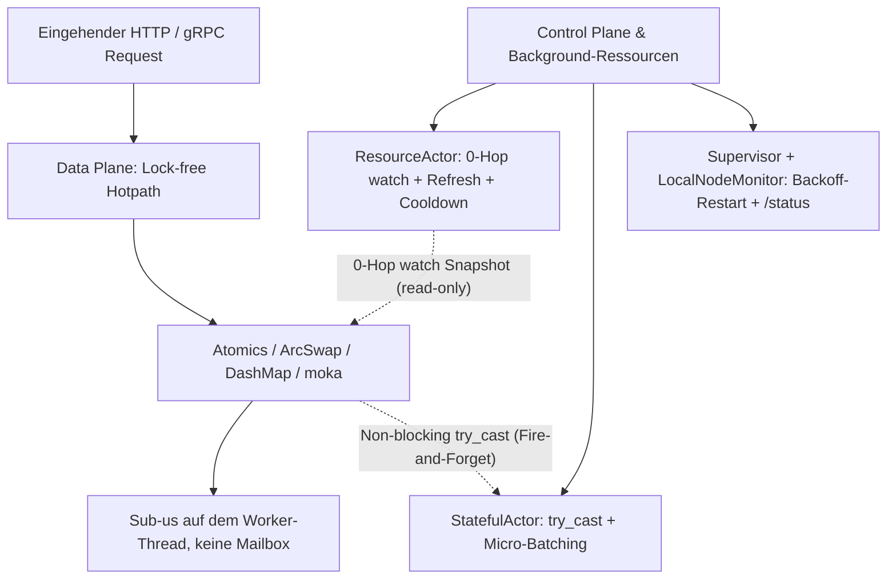

# Einsatzleitfaden: `otp-actor` in `praeco-rs`

**Stand:** 27.11.2026  
**Bezug:**  
- Actor-Framework (`otp-actor` v0.4.3): [otp-actor Cargo.toml](file:///Users/fredi/Data/Projekte/Rust/261102_actor/Cargo.toml), [actor/mod.rs](file:///Users/fredi/Data/Projekte/Rust/261102_actor/src/actor/mod.rs)  
- L2-Cache-Konzept (Dragonfly): [L2Cache.md](file:///Users/fredi/Data/Projekte/Rust/260225_Tower_Hyper_Rustls_refactor_client_gprc/L2Cache.md)

---

## 1. Leitprinzip: Klare Trennung von Data Plane und Control Plane

[`otp-actor`](file:///Users/fredi/Data/Projekte/Rust/261102_actor/src/actor/mod.rs#L1-L13) bringt in `praeco-rs` genau dort echten Mehrwert, wo **langlebige externe Ressourcen**, **überwachte Hintergrund-Loops** oder **Write-Behind-Pipelines** mit Restart-/Backoff-Logik verwaltet werden müssen (**Control Plane**). Im **synchronen Pro-Request-Hotpath (Data Plane)** sollte `praeco-rs` dagegen bewusst bei lock-freien Atomics, `ArcSwap`, sharded `DashMap` und `moka` bleiben.

### Bewertungs-Übersicht

| Subsystem / Use-Case | Empfehlung | `otp-actor`-Primitiv | Priorität / Nutzen |
| :--- | :--- | :--- | :--- |
| **gRPC-Reflection `DescriptorPool`** | **Ja (sehr sinnvoll)** | `ResourceActor` | **Hoch** – ersetzt manuelles `RwLock` + `Mutex` |
| **Dragonfly L2-Cache** | **Ja (konzipiert)** | `ResourceActor` + `StatefulActor` + `Supervisor` | **Hoch** – siehe [L2Cache.md](file:///Users/fredi/Data/Projekte/Rust/260225_Tower_Hyper_Rustls_refactor_client_gprc/L2Cache.md) |
| **CRL-Reload-Watcher / Remote-JWKS** | **Ja (sinnvoll)** | `ResourceActor` | **Mittel-Hoch** – Supervision + `force_refresh()` |
| **Active Health Checks & Tunnel-Daemons** | **Ja (sinnvoll)** | `Supervisor` (`OneForOne`) + `LocalNodeMonitor` | **Mittel** – ersetzt unüberwachtes `JoinSet<()>` |
| **Asynchrone Audit-/WAF-Event-Sinks** | **Ja (bei Bedarf)** | `StatefulActor` + `try_cast` | **Mittel** – entkoppeltes Write-Behind-Batching |
| **Hotpath-Middlewares (`RateLimiter`, `Rbac`, `Jwt`, `L1 moka`)** | **Nein (Anti-Pattern)** | – | Würde Mailbox-Bottleneck erzeugen |
| **`Singleflight` in `cache.rs`** | **Nein (Anti-Pattern)** | – | Kurzlebige URL-Keys brauchen `DashMap` |
| **`JwtRevocationStore` & IdP `SessionStore`** | **Nein (Anti-Pattern)** | – | Konkurrierende `DashMap`-Zugriffe wären durch Actor langsamer |
| **TCP/QUIC-Accept-Loops (`SocketReleaseBarrier`)** | **Nein (Anti-Pattern)** | – | Maßgeschneiderte Zero-Downtime-Socket-Übergabe |

---

## 2. Sinnvolle Einsatzstellen für `otp-actor` in `praeco-rs`

### Platz 1 (`ResourceActor`): gRPC-Reflection `DescriptorPool`-Cache
- **Aktuelle Stellen:** [`RouteTarget`](file:///Users/fredi/Data/Projekte/Rust/260225_Tower_Hyper_Rustls_refactor_client_gprc/server/src/configuration/resilience.rs#L427-L432) (`grpc_pool: tokio::sync::RwLock<Option<CachedDescriptorPool>>`, `grpc_reflection_lock: tokio::sync::Mutex<()>`) und der Refresh-Pfad in [grpc_web.rs](file:///Users/fredi/Data/Projekte/Rust/260225_Tower_Hyper_Rustls_refactor_client_gprc/server/src/middleware/router/grpc_web.rs#L316-L394).
- **Aktuelle Schwächen des Handbaus:**
  1. Jeder `grpc-web`-/`aggregate`-Request muss `target.grpc_pool.read().await` erwerben.
  2. Nach Ablauf der `reflection_ttl` zahlt der Request, der `try_lock()` gewinnt, die Netzwerklatenz von `build_grpc_pool` im Vordergrund (kein proaktiver Background-Refresh vor Ablauf).
  3. **Fehlender Failure-Cooldown:** Schlägt `build_grpc_pool` bei abgelaufenem Pool fehl, startet bereits der unmittelbar nächste Request wieder einen synchronen Reflection-Call gegen den gestörten Upstream.
- **Gewinn mit [`ResourceActor`](file:///Users/fredi/Data/Projekte/Rust/261102_actor/src/actor/generic_actor.rs#L1-L19):**
  - **0-Hop `watch`-Reads** via `ResourceClient::get()` ohne `RwLock` pro Request.
  - **Proaktiver Refresh** vor TTL-Ablauf (`expiry_buffer` + Jitter), sodass Requests keinen Stall erleben.
  - Eingebauter **`failure_cooldown`** (`DEFAULT_FAILURE_COOLDOWN`), **`stale_allowance`** (Stale-While-Error) und **`max_waiters`**-Backpressure-Schutz beim Kaltstart.

### Platz 2 (`ResourceActor` + `StatefulActor` + `Supervisor`): Dragonfly L2-Cache
- Vollständige Ausarbeitung mit 0-Hop `L2ConnectionActor`, micro-batchendem `L2WriterActor`, `spawn_scoped`-basiertem `L2InvalidationActor` und `OneForOne`-Supervision in [L2Cache.md](file:///Users/fredi/Data/Projekte/Rust/260225_Tower_Hyper_Rustls_refactor_client_gprc/L2Cache.md).

### Platz 3 (`ResourceActor`): CRL-Reload-Watcher & künftiger Remote-JWKS/OIDC-Refresh
- **CRL-Hot-Reload:** In [relay-server/src/tls.rs](file:///Users/fredi/Data/Projekte/Rust/260225_Tower_Hyper_Rustls_refactor_client_gprc/relay-server/src/tls.rs#L200-L290) läuft ein freier `tokio::spawn`-Loop mit `interval_at`, `SIGHUP`-Select und manuellem `watch::channel`. Panict der Task unerwartet, bleibt der letzte Stand eingefroren und CRL-Updates sterben stillschweigend. Mit `ResourceActor` erhält man denselben 0-Hop-`watch`-State inklusive Supervisor-Restart, `force_refresh()` bei `SIGHUP` und auslesbarem `CacheState` für Health-Probes.
- **Remote-JWKS (`/.well-known/jwks.json`):** Sollte [jwt.rs](file:///Users/fredi/Data/Projekte/Rust/260225_Tower_Hyper_Rustls_refactor_client_gprc/server/src/middleware/jwt.rs) künftig dynamische JWKS-Endpunkte unterstützen, ist `ResourceActor` der ideale Baustein: 0-Hop Key-Read pro Request, proaktiver Refresh vor Key-Rotation und gedrosseltes `force_refresh()` bei unbekannter `kid`.

### Platz 4 (`Supervisor` + `LocalNodeMonitor`): Active Health Checks & Relay-Tunnel-Daemons
- **Aktuelle Stellen:** [`spawn_router_health_checks_in`](file:///Users/fredi/Data/Projekte/Rust/260225_Tower_Hyper_Rustls_refactor_client_gprc/server/src/runner.rs#L719-L1021) und [`run_tunnel_with_dynamic_state`](file:///Users/fredi/Data/Projekte/Rust/260225_Tower_Hyper_Rustls_refactor_client_gprc/server/src/runner.rs#L1885-L1962) laufen heute als einfache Tasks in einem `JoinSet<()>`.
- **Risiko heute:** Bricht ein einzelner Health-Check-Task unerwartet ab, läuft der Server weiter, aber betroffene Upstreams werden unbemerkt nicht mehr aktiv geprüft.
- **Gewinn mit [`Supervisor`](file:///Users/fredi/Data/Projekte/Rust/261102_actor/src/actor/supervisor.rs) (`OneForOne`, `RestartType::Permanent`) + `LocalNodeMonitor`:**
  - Automatischer Restart mit Exponential Backoff (`RestartPolicy`).
  - Direkte Einbindung von `HealthState`, `restart_count` und Subtree-Status in den Admin-Endpoint `/status` ([admin.rs](file:///Users/fredi/Data/Projekte/Rust/260225_Tower_Hyper_Rustls_refactor_client_gprc/server/src/middleware/admin.rs)).

### Platz 5 (`StatefulActor` + `try_cast`): Asynchrone Security-/Audit-Event-Sinks (künftige Erweiterung)
- Falls WAF-Treffer (`inspection.rs`), Admin-Aktionen ([admin.rs](file:///Users/fredi/Data/Projekte/Rust/260225_Tower_Hyper_Rustls_refactor_client_gprc/server/src/middleware/admin.rs)) oder Login-/Revocation-Events künftig asynchron an ein externes SIEM oder Webhook-Ziel gesendet werden sollen:
  - Identisches Write-Behind-Muster wie `L2WriterActor`: non-blocking [`ActorClient::try_cast`](file:///Users/fredi/Data/Projekte/Rust/261102_actor/src/actor/stateful_actor.rs#L1622-L1643) aus dem Request-Pfad, bounded Mailbox, Micro-Batching via `ctx.send_after` und geordneter Drain in `on_stop`.

---

## 3. Anti-Patterns: Wo `otp-actor` **nicht** eingesetzt werden sollte

1. **Pro-Request-Middlewares im Hotpath:**
   - `IpFilter`, `PathSanitizer`, `Inspection`, `RateLimiter`, `ConcurrencyLimit`, `Rbac`, `ConnectionTracker`, `UpstreamNode`-Circuit-Breaker sowie der synchrone L1-`moka`-Pfad in [cache.rs](file:///Users/fredi/Data/Projekte/Rust/260225_Tower_Hyper_Rustls_refactor_client_gprc/server/src/middleware/cache.rs#L2614-L2653).
   - **Grund:** Diese Pfade arbeiten heute mit Atomics, `ArcSwap` und sharded `DashMap` in wenigen Nanosekunden direkt auf dem aufrufenden Tokio-Worker. Eine Actor-Mailbox pro Middleware würde jeden Request durch einen Single-Consumer-Flaschenhals serialisieren.
2. **`Singleflight` im Response-Cache ([cache.rs](file:///Users/fredi/Data/Projekte/Rust/260225_Tower_Hyper_Rustls_refactor_client_gprc/server/src/middleware/cache.rs#L94-L335)):**
   - **Grund:** `Singleflight` koalesziert tausende flüchtige URL-/Body-Keys pro Sekunde über eine sharded `DashMap` mit `Arc::ptr_eq`-Cleanup. `ResourceActor` ist für langlebige, benannte Ressourcen gedacht, nicht für dynamische Massen an Request-Keys.
3. **Konkurrierende In-Memory-Stores:**
   - [`JwtRevocationStore`](file:///Users/fredi/Data/Projekte/Rust/260225_Tower_Hyper_Rustls_refactor_client_gprc/server/src/middleware/jwt.rs#L60-L140) und IdP [`SessionStore`](file:///Users/fredi/Data/Projekte/Rust/260225_Tower_Hyper_Rustls_refactor_client_gprc/server/src/middleware/idp/session.rs#L122-L140).
   - **Grund:** Die `DashMap`-Operationen sind bereits hochgradig parallel; ein Umweg über `ActorClient::call` (`oneshot`-Allokation + Mailbox-Hop) würde Durchsatz kosten und Latenzen verschlechtern.
4. **TCP/QUIC-Accept-Loops & `SocketReleaseBarrier` ([server.rs](file:///Users/fredi/Data/Projekte/Rust/260225_Tower_Hyper_Rustls_refactor_client_gprc/server/src/server.rs#L330-L359)):**
   - **Grund:** Die zweiphasige `SIGHUP`-Übergabe („Listening-Socket sofort schließen gegen `EADDRINUSE`, bestehende Verbindungen parallel über `graceful_shutdown_timeout_seconds` auslaufen lassen“) ist dort bereits exakt auf Netzwerk-Listener zugeschnitten.

---

## 4. Entscheidungs-Checkliste für künftige Features

| Frage | Ergebnis |
| :--- | :--- |
| Muss pro HTTP/gRPC-Request auf viele dynamische Keys mit < 1 µs Latenz zugegriffen werden? | **Kein Actor** → `Atomic*`, `ArcSwap`, `DashMap`, `moka` |
| Wird eine langlebige externe Ressource (Schema, Token, JWKS, CRL, DB-/Cache-Client) mit TTL, Refresh und Cooldown gepflegt? | **`ResourceActor`** (0-Hop `watch` im Hotpath, Backpressure + Refresh im Hintergrund) |
| Müssen Events/Writes asynchron ohne Request-Blockade gepuffert, dedupliziert oder gebatcht werden? | **`StatefulActor` + `try_cast`** (bounded Mailbox + Budget-Cap) |
| Soll ein langlebiger Hintergrund-Worker bei Fehlern mit Backoff neu starten und im `/status` sichtbar sein? | **`Supervisor` (`OneForOne`, `Permanent`) + `LocalNodeMonitor`** |
